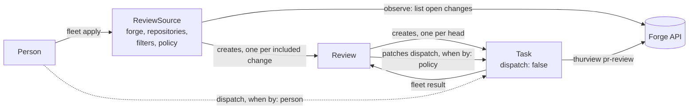

# Design

Status: design, for approval. Nothing here is implemented.

fleet-reviewer is a [Fleet](https://github.com/Thurbeen/fleet) plugin. It finds the open
pull and merge requests of a chosen set of repositories, and it starts one review Task per
change and per head commit. Each review Task reviews the change with
[thurview](https://github.com/Thurbeen/thurview) and follows thurview's `pr-review` rules.
The plugin is an external plugin controller: it defines two kinds of its own and creates
ordinary Tasks. Fleet core gains nothing review-specific
([Thurbeen/fleet#351](https://github.com/Thurbeen/fleet/issues/351)).

| Read | Answers |
| --- | --- |
| [Kinds](kinds.md) | What do `ReviewSource` and `Review` hold, and what are their JSON Schemas? |
| [State machine](state-machine.md) | How does one `Review` move from a new change to a retired record? |
| [Interface](interface.md) | What does each protocol call do, and what does each plan contain? |
| [Review Task](review-task.md) | Which Task does the plugin create, with which brief, and how does it follow it? |
| [Configuration](configuration.md) | How is the plugin registered, and where do identities and credentials come from? |
| [Fleet core](fleet-core.md) | What does the plugin need that the plugin contract does not give today? |
| [Open questions](open-questions.md) | What is still to decide, with a recommendation for each? |

## One run

1. A person applies a `ReviewSource`. It names one forge host, the token variable for that
   host, an explicit list of repositories, the filters, the TaskConfig the review Tasks run
   with, the output mode and the dispatch policy.
2. On each due pass the source asks the forge for the open changes of each repository,
   through the plugin's bounded `observe` call. It records each change and the filter
   verdict in its status. It creates one `Review` for each included change that has no
   `Review` yet.
3. Each `Review` reads its source and its current Task from the store. When the change's
   head has no review yet, the `Review` creates one Task for that head, with
   `dispatch: false`.
4. A person dispatches the Task, or the policy dispatches it when fewer than `maxActive`
   review Tasks of the source run.
5. The Task's agent session reviews the change with thurview. It posts one summary and one
   thread per finding, or it only reports, as the source says. It records a result with the
   head it reviewed and the confidence.
6. The `Review` reads the result and records it. A new push starts again at step 3 for the
   new head. A merged or closed change settles the `Review`; after a retention the `Review`
   deletes its Tasks and then itself.

## Why a plugin

- The decisions are review-specific: which changes, which filters, which brief. Fleet core
  stays a host for Tasks and controllers.
- The plugin contract already has every verb the flow needs: own kinds, Task create,
  `dispatch` patch, inbox append, Task delete, store probes and bounded forge reads.
- The plugin persists nothing outside the status of its objects. A crash between two passes
  loses nothing that the next pass cannot recompute.

## Rules

These rules generalise what manual review runs showed.

| Rule | Where it is kept |
| --- | --- |
| A review is scoped. A source names its repositories explicitly; there is no "every repository I can see". | [`ReviewSource.spec.repositories`](kinds.md#reviewsource) |
| Removing a repository from a source cancels its reviews, running ones included. | [State machine](state-machine.md#transitions) |
| Bots, deleted users, drafts, stale changes and the reviewer's own changes are excluded by default. | [Filters](kinds.md#filters) |
| Identity and harness are per forge. Each source names its token variable and its TaskConfig. | [Configuration](configuration.md#identities) |
| One review per head commit. A new push gets a new review; no head is reviewed twice. | [New push](review-task.md#a-new-push) |
| Posting or report-only is a setting, and report-only is the default. | [`review.output`](kinds.md#reviewsource) |
| A review can run without publishing a page, and that is the default. | [`review.page`](kinds.md#reviewsource) |
| At most `maxActive` review Tasks of a source run at once. | [Dispatch](review-task.md#dispatch) |
| Forge calls stay under a per-host budget and back off on a rate limit. | [Rate limits](interface.md#rate-limits) |
| An Unknown answer never means absent, closed or empty. | [Unknown answers](interface.md#unknown-answers) |

## Scope

In scope: GitHub and GitLab, on their public hosts and self-hosted; discovery, filters,
one Task per head, dispatch by policy or by a person, following the Task, retiring what
the plugin made.

Out of scope, deliberately:

- Posting on the forge from the plugin. Every forge write is the review Task's, through
  thurview. The plugin plans no effects.
- Approving, merging or closing a change. thurview has no verb for these, and the plugin
  adds none.
- Reviewing a change that is not in a source's repositories, however it is found.
- Other forges. The observer half has one adapter per forge; adding one is a later change.
