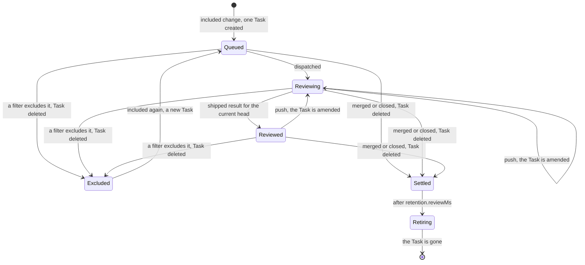

# State machine

Fleet defines how an object of a plugin kind moves through one pass: probes, reconcile,
the gate, the status write, the verbs. This page defines what the plugin decides in that
pass. The [interface](interface.md) defines the probes and the plans.

A `Review` has one review Task, named after the `Review`, for the life of the change. An
Unknown answer causes no transition.

## Inputs of a Review pass

A `Review` decides from four observations. Each is Known or Unknown.

| Observation | Probe | Asked |
| --- | --- | --- |
| `source` | Store: the `ReviewSource` named in `spec.source` | Every pass. |
| `task` | Store: the Task named after the `Review` | Every pass. |
| `queue` | Store: Tasks labelled `fleet-reviewer/source: <source>` | When the Task waits for dispatch under `policy`. |
| `change` | Plugin: `readChange`, one forge call | When the change is missing from the source's last complete listing. See [Closed changes](#closed-changes). |

The source's status carries the change as last listed: head, draft state, labels and the
filter verdict. A `Review` therefore reads the forge only to tell a closed change from
one that is no longer listed.

## Phases

| Phase | Meaning |
| --- | --- |
| `Queued` | The Task exists and is not dispatched. |
| `Reviewing` | The Task is dispatched, and the current head has no `shipped` result. |
| `Reviewed` | The current head has a recorded `shipped` result. |
| `Excluded` | The source lists the change, and a filter excludes it. |
| `Settled` | The forge says the change is merged or closed. |
| `Retiring` | The `Review` deletes its Task, then itself. |

## Transitions

Every pass first records each new result of the Task in `reviews`, one per generation.
Then the rules are checked in order. The first rule that matches decides the pass.

| # | Condition | Next phase | Plan |
| --- | --- | --- | --- |
| 1 | The `Review` is deleting. | `Retiring` | Delete the Task. Remove the finalizer once the `task` probe answers `known: null`. |
| 2 | `source` is Unknown, or `task` is Unknown. | unchanged | Nothing. `notBefore = now + 300000`. |
| 3 | `source` is `known: null`, or the source is deleting. | `Retiring` | Delete the Task, running or not. |
| 4 | The project is no longer in the source's `spec.repositories`. | `Retiring` | Delete the Task, running or not. A person narrowed the scope; this is the cancel. |
| 5 | `Retiring`, and the `task` probe answers `known: null`. | gone | `delete: true`. |
| 6 | `Settled`, and `settledAt + retention.reviewMs` is past. | `Retiring` | Nothing more to delete. |
| 7 | `change` answers `merged` or `closed`, or the phase is `Settled`. | `Settled` | Delete the Task, running or not. The review ends with the change. |
| 8 | The change is missing from the listing, and `change` answers `open` or Unknown. | unchanged | Nothing. The next pass asks again, after the source's next listing. |
| 9 | The source is suspended. | unchanged | Nothing is created, amended or dispatched. A running Task continues. |
| 10 | The listing excludes the change. | `Excluded` | Delete the Task, running or not. An unrequested reviewer stops the review. |
| 11 | The `Review` recorded a Task `uid`, and `task` is `known: null`. | `Reviewed` | Add the Task's head to `cancelled`. A person deleted it. A later push creates a new Task. |
| 12 | The Task is Stalled, or raises `NeedsAttention`. | unchanged | Raise `NeedsAttention` naming the Task's reason. A person decides. |
| 13 | No Task, and the current head has no `shipped` result and is not `cancelled`. | `Queued` | Create the Task for the current head, `dispatch: false`. |
| 14 | The Task was never asked about the current head. | unchanged until rule 15 to 19 | Amend the Task with the new head, `ifGeneration` set to the Task's generation. See [A new push](review-task.md#a-new-push). |
| 15 | The Task is not dispatched, `dispatch.by: policy`, and the Task is first in the [queue](review-task.md#dispatch). | `Reviewing` | Patch the Task's `dispatch` to `true`. |
| 16 | The Task is not dispatched. | `Queued` | Nothing more. Set `Dispatched=False` with the reason: `AwaitingPerson` or `AtCapacity`. |
| 17 | The current head has a `shipped` result, and no amendment was planned. | `Reviewed` | Nothing. |
| 18 | The latest result for the current head is not `shipped`, and no amendment was planned. | `Reviewing` | Raise `NeedsAttention/ResultNotShipped` naming the Task and the outcome. A person decides. |
| 19 | Otherwise. | `Reviewing` | Nothing. |

A head the Task "was asked about" is the head of its brief, or a head named in one of its
amendments. The plugin reads both from the stored Task, so a lost status never sends an
amendment twice. A person may dispatch a queued Task at any time, whatever the policy.
The plugin never sets `dispatch` back to `false`.

## Timing

| Phase | `notBefore` |
| --- | --- |
| `Reviewing` | `now + 60000`: the plugin follows the Task closely. |
| `Queued` under `policy` | `now + 60000`: a slot may free up. |
| `Queued` under `person`, `Reviewed`, `Excluded` | The source's own `notBefore` plus 5000: nothing changes before the next listing. |
| `Settled` | `settledAt + retention.reviewMs`, checked at least every 10 minutes. |
| `Retiring` | `now + 30000`, until the Task is gone. |

A spec change of the source does not make its Reviews due. Rules 3 and 4 apply on each
Review's next pass, within the source's poll interval.

## A ReviewSource pass

A source has no phase machine of its own beyond `Listing`, `Suspended` and `Throttled`.
Each pass does this:

1. Read every `ReviewSource` from the store, and this source's Reviews by label.
2. Stop at `Suspended` when `spec.suspend` is `true`. Nothing is listed or created.
3. Stop at `Throttled` while any source on the same host has `throttle.until` in the
   future. `notBefore` is that time.
4. Read `whoami` when `account` is missing or older than one day.
5. List each repository that is due and fits in the host's remaining budget, oldest
   `listedAt` first. See [Rate limits](interface.md#rate-limits).
6. Replace the entries of each repository that answered Known. Keep the entries of each
   repository that answered Unknown.
7. Apply the [filters](kinds.md#filters) to every entry.
8. Create a `Review` for each included change that has none, at most 20 per pass. More
   wait for the next pass, which is due in 5 seconds.
9. Raise `Overlap` for each change whose `Review` names another source.

The source never deletes a `Review`. Each `Review` retires itself from what it reads.

A deleted `Review` keeps its name until its Task is released. While an included change's
`Review` is deleting, the source marks the entry `reviewState: deleting` and sets
`notBefore` to `now + 30000`, or `pollMs` when that is shorter. The first pass after the
`Review` is gone creates a new one, which briefs a new Task for the current head. Deleting
a `Review` is therefore how a person restarts a review.

## Closed changes

A listing holds open changes only. A change missing from the listing may be merged, closed
or beyond the listing's bound. Absence is not proof that the change closed. A `Review`
whose change is missing from the last complete listing asks the forge once, with
`readChange`:

| Answer | Decision |
| --- | --- |
| `merged` or `closed` | Rule 7: `Settled`. |
| `open` | Rule 8. The source raises `NeedsAttention/TooMany` when a listing reaches its bound. |
| Unknown | Rule 8. Asked again after the source's next listing. |

The `Review` does not ask while the host is throttled. It reads the throttle from its
source's status.

## Deletion

| Deleted object | What follows |
| --- | --- |
| The review Task, by a person | Rule 11: the head is `cancelled`. The plugin creates a new Task only for a later head. |
| A `Review`, by a person | Rule 1: its Task is deleted, then the finalizer is removed. If the change is still listed, the source creates a new `Review` on its next pass. To stop reviewing a change, exclude it in the source. |
| A `ReviewSource`, by a person | Rule 3 on each `Review`: the Task is deleted, then each `Review`. |
| A Task the plugin deleted | The Task's own controller releases its session, as for any deletion. |

## Conditions

| Kind | Type | Status when |
| --- | --- | --- |
| `Review` | `Reviewed` | `True` when the current head has a `shipped` result. |
| `Review` | `Dispatched` | `False/AwaitingPerson`, `False/AtCapacity`, `False/Suspended`, `True`. |
| `Review` | `NeedsAttention` | The Task stalled, the latest result for the current head is not `shipped`, a plan was refused (`host.error`), or a verb was refused (`host.verbs`). |
| `ReviewSource` | `Listed` | `True/Complete` when every repository answered Known on its last listing. |
| `ReviewSource` | `Throttled` | `True` while `throttle.until` is in the future. |
| `ReviewSource` | `Overlap` | `True` when another source owns one of this source's changes. |
| `ReviewSource` | `NeedsAttention` | `InvalidSpec`, `TooMany`, `Unauthorized`, or a refused plan. |

Each condition keeps its `lastTransitionTime` until its status changes, so a quiet pass
writes nothing new.
